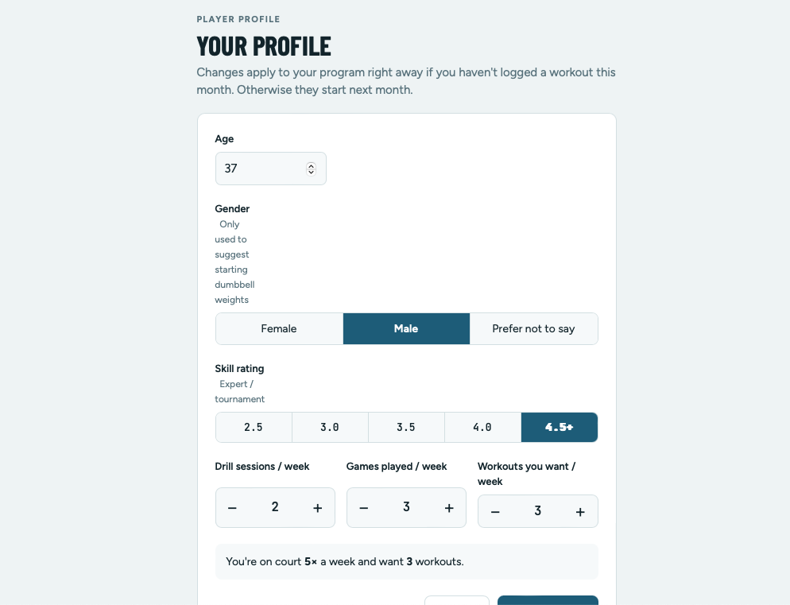
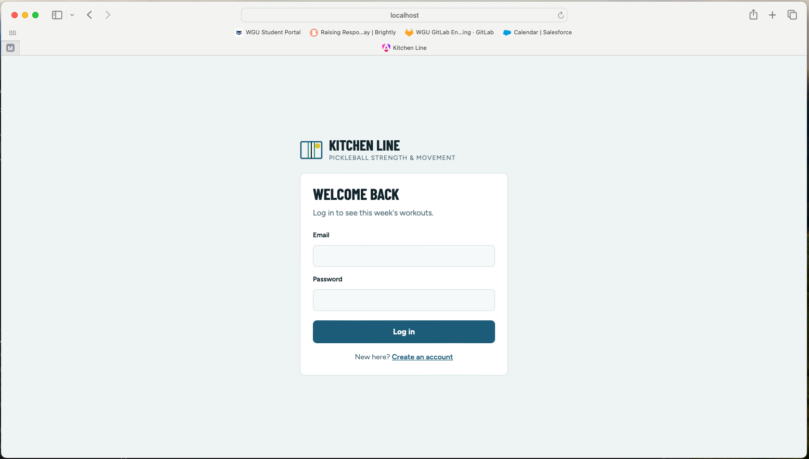

# Kitchen Line Web

Angular front end for **Kitchen Line**, a pickleball strength and movement app that builds a personalized 4-week progressive-overload program from a player's age, skill rating and weekly court time.

**Backend:** [kitchenline-api](https://github.com/mranda88/kitchenline-api)
**Live demo:** _coming soon_

| Program | Profile | Sign up |
|---|---|---|
|  |  |  |

---

## Features

- **Sign-up, login and logout,** with route guards that send players to the right screen.
- **Player profile form:** age, gender, skill rating (2.5–4.5+) and − / + counters for drills, games and workouts, with a live weekly summary.
- **Program screen:**
  - Intensity tier, stats and coaching notes
  - A suggested Monday–Sunday schedule built around court sessions
  - Week tabs (Groove, Volume, Sets, Load)
  - Workout cards with sets × reps, target effort (RPE), suggested weights and tap-to-expand coaching cues
- **Progress tracking:** check off workouts with a progress bar. Finishing 75% unlocks the next month.
- Responsive from phone to desktop, with light and dark themes.

## Tech stack

Angular 22 (standalone components, signals, zoneless) · TypeScript · HttpClient · Angular Router · CSS custom properties

## Structure

```
src/app/
├── core/
│   ├── models.ts            TypeScript types matching the API's JSON
│   ├── auth.service.ts      Login state (a signal) and /api/auth calls
│   ├── auth.guards.ts       Logged-in and logged-out route guards
│   ├── training.service.ts  /api/profile and /api/program calls
│   ├── week-plan.ts         Suggested weekly schedule and warm-ups
│   └── errors.ts            Turns server errors into readable messages
└── pages/
    ├── auth-page/           Login and sign-up (one component, two modes)
    ├── profile-page/        The six-question profile form
    └── home-page/           The program screen
```

## Highlights

- **Signals throughout.** Page state is held in a few signals, and everything else (current week, schedule, progress) is `computed`, so the screen can't fall out of sync.
- **Server as the source of truth.** Every check-off returns the updated program and progress from the API, and the page shows exactly that.
- **CSRF handled automatically.** Angular's HttpClient reads the `XSRF-TOKEN` cookie and sends it back as a header. The login cookie itself is HttpOnly and never touched by JavaScript.
- **Accessible controls.** Choice buttons are real radio inputs, counters announce their values, and keyboard focus is always visible.

## Running locally

**Requirements:** Node 24+, the [backend](https://github.com/mranda88/kitchenline-api) running on port 8080

```bash
npm install
npm start
```

Open http://localhost:4200. In development, `proxy.conf.json` forwards `/api` requests to the backend, so the browser sees a single site.
